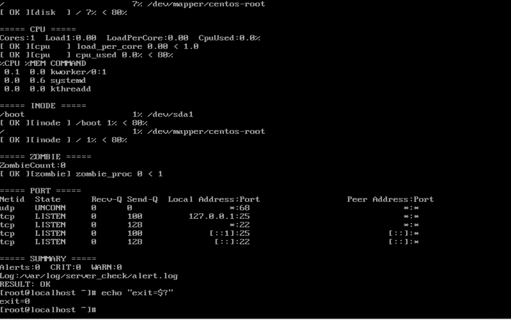
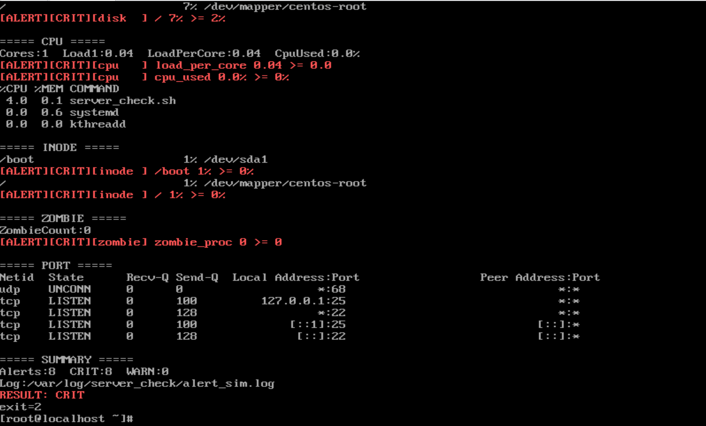

# CentOS 7 服务器巡检 Shell 脚本

## ✅ 项目简介

面向 CentOS 7 的服务器巡检脚本。在原「基础信息打印版」基础上扩展为「采集 + 阈值判断 + 告警」的巡检工具，一条命令输出全部检查项结论，并支持定时巡检、告警日志落盘、退出码对接监控。

脚本特点：

- 纯 bash + 系统自带命令（`awk / ps / df / free / ss`），无需安装任何第三方包
- 脚本内容全为英文（纯 ASCII）+ LF 换行，避免 CentOS 终端中文乱码和 `$'\r'` 报错
- 每个检查项都是 `[ALERT]` / `[ OK ]` 二选一输出，未触发也给出结论
- 告警同时写日志，退出码可被 cron / Zabbix / Jenkins 直接判断

运行效果见下方「📤 输出示例」里的两张实拍截图：图 1 正常状态、图 2 告警状态，原始图片在 `images/` 目录。

## 🔍 检查项与阈值

| 检查项 | 输出段 | 判断依据 | 默认阈值 |
| --- | --- | --- | --- |
| 系统信息 | `SYSTEM` | 主机名、系统版本、内核、时间、运行时长 | 仅展示 |
| 内存 | `MEMORY` | `(MemTotal - MemAvailable) / MemTotal` | WARN 80% / CRIT 90% |
| 磁盘使用率 | `DISK` | `df -PT` 各分区使用率（排除 tmpfs、devtmpfs、squashfs、iso9660、autofs） | WARN 80% / CRIT 90% |
| CPU 动态负载 | `CPU` | 单核 1 分钟负载（load1 / 核数）+ 采样 1 秒的 CPU 使用率 | 负载 1.0 / 2.0，CPU 80% / 90% |
| Inode 节点 | `INODE` | `df -PiT` 各分区 Inode 使用率 | WARN 80% / CRIT 90% |
| 僵尸进程 | `ZOMBIE` | `ps -eo stat=` 中状态以 `Z` 开头的进程数 | WARN 1 / CRIT 10 |
| 监听端口 | `PORT` | `ss -tuln`（无 ss 时降级 netstat） | 仅展示 |
| 汇总 | `SUMMARY` | 告警总数、日志路径、巡检结果 | — |

阈值全部集中在脚本第 5–10 行，改完保存即生效：

```bash
MEM_W=80;   MEM_C=90      # 内存
DISK_W=80;  DISK_C=90     # 磁盘使用率
INODE_W=80; INODE_C=90    # Inode
LOAD_W=1.0; LOAD_C=2.0    # 单核 1 分钟负载
CPU_W=80;   CPU_C=90      # CPU 使用率
ZOMB_W=1;   ZOMB_C=10     # 僵尸进程数
```

判据是 `>=`，等于阈值就告警。`WARN` 是该处理了，`CRIT` 是现在就要处理。

## 📤 输出示例

### 正常状态

CentOS 7 最小化安装，全部检查项低于阈值。



*图 1 正常状态：`RESULT: OK`，`exit=0`。截图为终端回滚后的片段，顶部 `SYSTEM` / `MEMORY` 两段与 `DISK` 段前半未截入。*

对应的文本输出：

```text
/                      7% /dev/mapper/centos-root
[ OK ][disk  ] / 7% < 80%

===== CPU =====
Cores:1  Load1:0.00  LoadPerCore:0.00  CpuUsed:0.0%
[ OK ][cpu   ] load_per_core 0.00 < 1.0
[ OK ][cpu   ] cpu_used 0.0% < 80%
%CPU %MEM COMMAND
 0.1  0.0 kworker/0:1
 0.0  0.6 systemd
 0.0  0.0 kthreadd

===== INODE =====
/boot                  1% /dev/sda1
[ OK ][inode ] /boot 1% < 80%
/                      1% /dev/mapper/centos-root
[ OK ][inode ] / 1% < 80%

===== ZOMBIE =====
ZombieCount:0
[ OK ][zombie] zombie_proc 0 < 1

===== PORT =====
Netid State  Recv-Q Send-Q Local Address:Port   Peer Address:Port
udp   UNCONN 0      0                  *:68                *:*
tcp   LISTEN 0      100        127.0.0.1:25                *:*
tcp   LISTEN 0      128                *:22                *:*
tcp   LISTEN 0      100            [::1]:25             [::]:*
tcp   LISTEN 0      128               [::]:22             [::]:*

===== SUMMARY =====
Alerts:0  CRIT:0  WARN:0
Log:/var/log/server_check/alert.log
RESULT: OK
```

### 告警状态

把阈值压到 0 附近触发全部检查项（复现方法见「验证告警是否生效」）。



*图 2 告警状态：`RESULT: CRIT`，`exit=2`，`Alerts:8` 全是 CRIT。截图为终端回滚后的片段，顶部 `SYSTEM` / `MEMORY` 两段与 `DISK` 段前半未截入。日志名是 `alert_sim.log`——验证时跑的是改过阈值的副本，正式运行写 `alert.log`。*

对应的文本输出：

```text
[ALERT][CRIT][disk  ] / 7% >= 2%

===== CPU =====
Cores:1  Load1:0.04  LoadPerCore:0.04  CpuUsed:0.0%
[ALERT][CRIT][cpu   ] load_per_core 0.04 >= 0.0
[ALERT][CRIT][cpu   ] cpu_used 0.0% >= 0%
%CPU %MEM COMMAND
 4.0  0.1 server_check.sh
 0.0  0.6 systemd
 0.0  0.0 kthreadd

===== INODE =====
/boot                  1% /dev/sda1
[ALERT][CRIT][inode ] /boot 1% >= 0%
/                      1% /dev/mapper/centos-root
[ALERT][CRIT][inode ] / 1% >= 0%

===== ZOMBIE =====
ZombieCount:0
[ALERT][CRIT][zombie] zombie_proc 0 >= 0

===== SUMMARY =====
Alerts:8  CRIT:8  WARN:0
Log:/var/log/server_check/alert_sim.log
RESULT: CRIT
```

告警行格式为 `[ALERT][级别][检查项] 指标名 实测值 >= 阈值`，同一行同时追加到告警日志：

```text
[ALERT][WARN][disk  ] / 85% >= 80%
[ALERT][CRIT][mem   ] mem_used 93.5% >= 90%

2026-11-16 13:45:01 [WARN][disk  ] / 85% >= 80%
```

告警日志路径：root 为 `/var/log/server_check/alert.log`，普通用户为 `/tmp/server_check/alert.log`，脚本按 `id -u` 自动选择并在 `SUMMARY` 段打印实际路径。

## 🚦 退出码

| 退出码 | 含义 | 对应结果 |
| --- | --- | --- |
| 0 | 全部检查项低于告警阈值 | `RESULT: OK` |
| 1 | 存在 WARN 级告警 | `RESULT: WARN` |
| 2 | 存在 CRIT 级告警 | `RESULT: CRIT` |

用 2 而不是 1 表示严重，是为了让调用方能区分两种告警。代价是只认「0 成功、非 0 失败」的地方（`cmd && ...`、部分 Jenkins 配置、默认的 cron 告警）会把 CRIT 当成普通失败，需要单独判断：

```bash
/root/server_check.sh
case $? in
    0) echo "OK" ;;
    1) echo "WARN" ;;
    2) echo "CRIT" ;;
esac
```

## 📌 运行环境

CentOS 7（最小化安装即可，依赖 `bash`、`awk`、`ps`、`df`、`free`、`ss`）

- 浮点比较由 `awk` 完成，因为最小化安装没有 `bc`
- `ss` 来自 `iproute`，系统自带；`netstat` 来自 `net-tools`，CentOS 7 默认不安装，所以脚本优先用 `ss`
- 脚本用了进程替换 `< <(...)`，这是 bash 特性，在 `/bin/sh` 不是 bash 的系统上要用 `bash server_check.sh` 显式指定解释器

## 📝 使用步骤

1. 在 CentOS 7 终端整段粘贴以下命令（heredoc 一次性写入文件，避免手工复制出错；粘贴注意见 [error-log.md](error-log.md)）：

   ```bash
   cat > /root/server_check.sh <<'EOF'
   ...脚本内容...
   EOF
   ```

   也可以从仓库取：在仓库页面点 **Code → Download ZIP**，解压后把 `server_check.sh` 传到目标机：

   ```bash
   scp server_check.sh root@192.168.1.10:/root/   # 192.168.1.10 换成目标机 IP
   ```

2. 添加执行权限（网页上传或 ZIP 下载的文件没有执行位，这一步不能省）：

   ```bash
   chmod +x /root/server_check.sh
   ```

3. 写入校验，四项都要通过：

   ```bash
   wc -l /root/server_check.sh            # 109
   head -1 /root/server_check.sh          # #!/bin/bash
   bash -n /root/server_check.sh && echo syntax_ok
   grep -c $'\r' /root/server_check.sh    # 必须输出 0
   ```

   `bash -n` 只验语法，查不出 Windows 换行。`\r` 藏在行尾时语法依然成立，一执行才报 `$'\r': command not found`，所以换行那项要单独检查。

4. 执行并查看退出码：

   ```bash
   /root/server_check.sh
   echo "exit=$?"
   ```

5. 配置定时巡检（每小时一次）。先建日志目录，否则重定向打不开文件、任务静默不执行：

   ```bash
   mkdir -p /var/log/server_check
   ```

   再用 `crontab -e` 添加，不要 `echo >> /var/spool/cron/root`（原因见 [error-log.md](error-log.md)）：

   ```cron
   0 * * * * /root/server_check.sh >> /var/log/server_check/cron.log 2>&1
   ```

6. 告警日志只追加不轮转，长期跑会把自己的磁盘告警刷出来，配上 logrotate：

   ```bash
   cat > /etc/logrotate.d/server_check <<'EOF'
   /var/log/server_check/*.log {
       weekly
       rotate 8
       compress
       missingok
       notifempty
       copytruncate
   }
   EOF
   ```

## 🧪 验证告警是否生效

不必真的把磁盘写满，用 `sed` 临时把阈值压到 0 附近跑一次即可，不改动原文件。上面那张告警截图就是这么跑出来的：

```bash
sed -e 's/^MEM_W=80;   MEM_C=90/MEM_W=0;    MEM_C=0/' \
    -e 's/^DISK_W=80;  DISK_C=90/DISK_W=1;  DISK_C=2/' \
    -e 's/^INODE_W=80; INODE_C=90/INODE_W=0; INODE_C=0/' \
    -e 's/^LOAD_W=1.0; LOAD_C=2.0/LOAD_W=0.0; LOAD_C=0.0/' \
    -e 's/^CPU_W=80;   CPU_C=90/CPU_W=0;   CPU_C=0/' \
    -e 's/^ZOMB_W=1;   ZOMB_C=10/ZOMB_W=0;   ZOMB_C=0/' \
    /root/server_check.sh | bash
echo "exit=$?"
```

预期看到 `[ALERT][CRIT][disk  ] / 7% >= 2%`、`RESULT: CRIT`、`exit=2`。只想验证 WARN 分支，单独压磁盘阈值就够了，不要再带上面那几条：

```bash
sed 's/^DISK_W=80;  DISK_C=90/DISK_W=5;  DISK_C=90/' /root/server_check.sh | bash
echo "exit=$?"
```

预期 `[ALERT][WARN][disk  ] / 7% >= 5%`、`RESULT: WARN`、`exit=1`。

`sed` 的匹配串依赖阈值行里的空格数量，改过阈值后会对不上，此时 `sed` 不报错、原样输出原文，表现就是「阈值没变」。

## 📄 已知限制

- 挂载点含空格时 `while read -r m p d` 会把列切开，列会错位；需要支持时按行尾最后一个字段取挂载点
- CPU 使用率是 1 秒采样，只反映执行瞬间，短时尖峰可能采样不到
- 阈值是绝对值，不与历史基线比较，也不考虑业务周期
- 不检查 NTP 时间偏差、SELinux、firewalld 规则、服务存活、进程数与文件句柄
- 内核没有 `MemAvailable` 时脚本退回 `MemFree + Buffers + Cached`，这个近似值偏小，算出的使用率偏高，可能误报

## 📂 文件说明

- `server_check.sh`：巡检脚本主体（纯 ASCII、LF 换行）
- `README.md`：使用说明（本文档）
- `error-log.md`：实操遇到的报错、原因以及解决办法
- `images/`：README 引用的输出截图（`status-normal.png` 为图 1、`status-warning.png` 为图 2）
- `.gitattributes`：强制 `*.sh` 用 LF 检出，避免 Windows 侧提交后带上 CRLF
- `.gitignore`：忽略编辑器临时文件和运行产生的 `*.log`

## ⚠️ 踩坑记录

部署和排错时踩过的坑（vi / vim、网络重启、脚本传输与编码、定时任务），详细报错原因和解决方案请看：[error-log.md](error-log.md)
